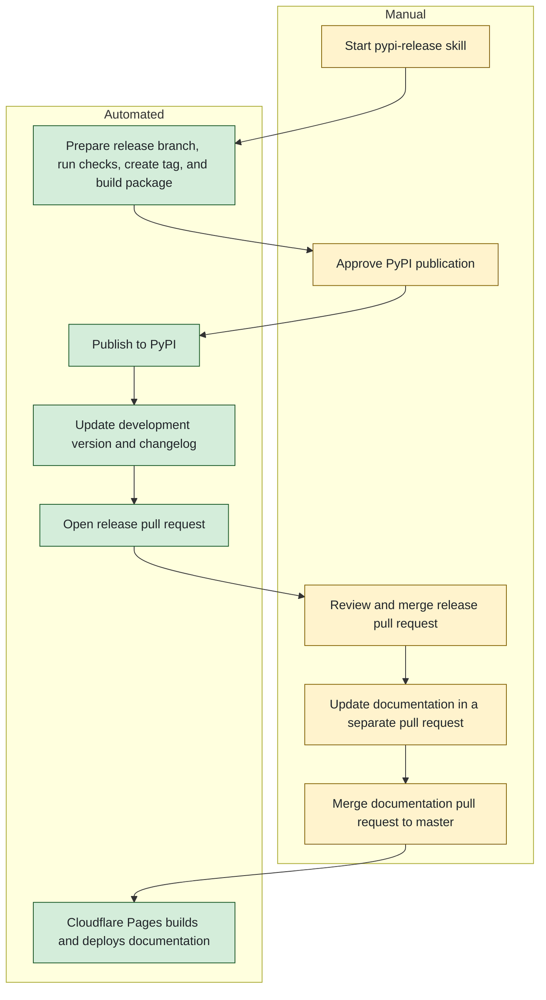

## Release procedure

Before starting the release, set `UV_PUBLISH_TOKEN` in the environment used to run the `pypi-release` skill.

1. Use the `pypi-release` skill in `.agents/skills/pypi-release/SKILL.md` to prepare a PyPI release. For example:

```text
Use the `pypi-release` skill to prepare the Janome 0.5.2 release for PyPI.
```

2. Review and merge the pull request created by the `pypi-release` skill.

3. Update the documentation for every release in a separate pull request. After it is merged into `master`, Cloudflare Pages automatically builds and deploys the documentation.

How it works: The skill prepares the release on a dedicated branch, runs the project checks, creates a release tag, and builds the package. It requests approval before publishing to PyPI. After publication, it updates the development version and changelog, then opens a pull request for review. Documentation changes are handled separately.

The release flow is shown below:


